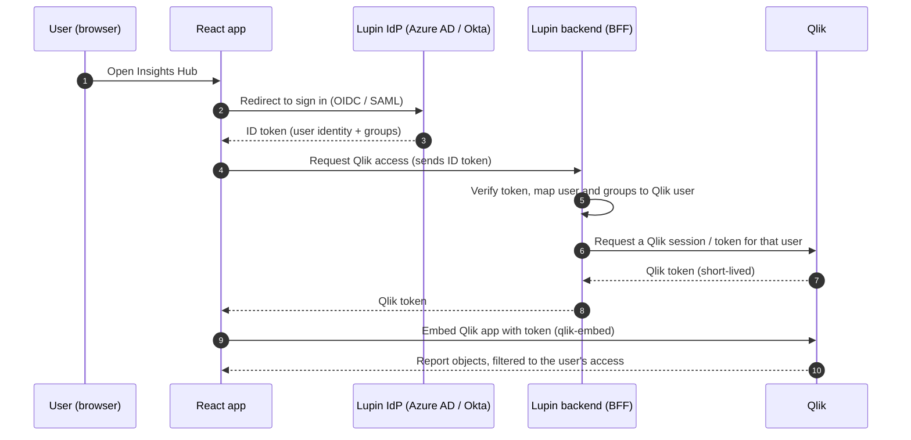
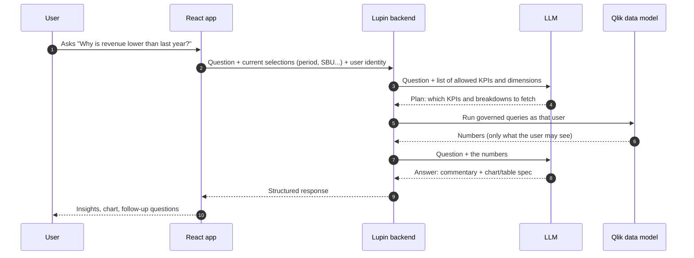

# Lupin Insights Hub: User Story and Solution Walkthrough

Client meeting document. It covers the layout, how Qlik sign-in works in the React app, how users ask questions about reports, and what the left-panel navigation can hold.

> **What the demo shows today vs. what this document proposes.** The running demo has the Qlik-style dashboard (5 sheets, filters) and the chatbot panel. The left navigation rail in section 3, and the Token Usage report, are proposed screens for discussion and are not built in the demo yet.

---

## 1. The story

**Persona:** Priya, a Commercial Analyst at Lupin. She reviews sales and margin every week in Qlik, and when a number looks wrong she has to ask a colleague or export to Excel to find out why.

### Primary user story

> **As** a Lupin commercial analyst,
> **I want** to see my existing Qlik reports and ask questions about them in plain English on the same page,
> **so that** I can understand *why* a number moved without leaving the report, building a new chart or waiting for a colleague.

### Supporting stories

| # | As a... | I want... | So that... |
|---|---|---|---|
| 1 | User | to sign in once with my Lupin account | I do not log in again to Qlik |
| 2 | User | my Qlik dashboards to look and behave exactly as they do today | no retraining and no rebuilt reports |
| 3 | User | the assistant to know what I am looking at (my filters, period, sheet) | I can ask "why is this lower?" without repeating context |
| 4 | User | answers as charts, tables and short commentary | I can read and reuse them quickly |
| 5 | User | my last chats kept | I can return to an earlier analysis |
| 6 | Manager | to see which questions people ask | I can see where reports fall short |
| 7 | IT / Finance owner | to see AI token usage by user and department | I can control cost |
| 8 | Admin | role-based access to the same data users already have in Qlik | the assistant never reveals data a user cannot see in Qlik |

### Acceptance criteria for the primary story

- The user signs in once and lands on the dashboard with the Qlik app already loaded.
- The assistant opens from an icon, can be collapsed, and never hides the report (the report area resizes).
- Questions such as *"Why is our revenue lower than last year?"* return a ranked explanation with numbers that **match the dashboard**.
- Answers can include a pie, bar or line chart, a table or commentary, as the question needs.
- The assistant respects the user's Qlik access: it only answers from data the user may see.
- The last two chat sessions are available in History.

---

## 2. Proposed layout

### 2.1 Overall screen

```
+----------------------------------------------------------------------------------------+
| [LUPIN]  Insights Hub  ›  Commercial Performance            [INR|USD]   🔔   (PR) ▾    |  <- top bar
+--------+---------------------------------------------------------------+---------------+
|  NAV   |  Qlik app: Lupin Commercial Performance                       |  Lupin AI     |
|        |  [Overview][Top N][Variance][What-If][Currency]   ↶ ↷ ⌫       |  Assistant    |
| ▣ Dash |  Selections: (Apr26–Sep26 ×) (SBU: US Generics ×)             | [+][⟲][⤢][»]  |
| ✦ Ask  +-----------+---------------------------------------------------+               |
| ☰ Rpts | FILTERS   | [Net Sales][Volume][ASP][COGS][Margin][Margin %]  | 🧑 Why is our |
| ◔ Token| Calendar  | +-------------------------+ +-------------------+ |   revenue     |
| ★ Saved| Scenario  | | Actual vs Budget (line) | | Sales by SBU      | |   lower?      |
| ⚙ Admin| SBU       | +-------------------------+ +-------------------+ | 🤖 Down 3.2%… |
|        | Therapy…  |                                                   |  ① US price   |
|        |           |   (embedded Qlik app: Qlik objects render here)   |  ② volumes    |
|        |           |                                                   | [Ask anything]|
+--------+-----------+---------------------------------------------------+---------------+
                                  Powered by Qlik Sense                          (💬)
```

**Four zones:**

1. **Top bar:** brand, page context, currency, notifications, user menu.
2. **Left navigation rail (proposed):** switches between sections of the product (see section 5).
3. **Main canvas:** the embedded Qlik app with its own sheet tabs, selections bar and filters.
4. **Assistant dock (right):** the chatbot. Collapses to a floating icon; expands to about 430 px, or wider when maximised. The canvas resizes instead of being covered.

### 2.2 Why this layout

- **Reports stay the hero.** Nothing is rebuilt; Qlik renders as it does today.
- **The assistant sits beside the data, not in a separate app.** It can read what is on screen.
- **A left rail makes the product extensible.** New capabilities (token usage, saved insights) become new rail entries, not new tools.

---

## 3. How Qlik authentication works in the React app

The React app never stores Qlik credentials. The user signs in to **Lupin's identity provider (IdP) once**, and the app obtains a Qlik session for that same user.

> **To confirm with Lupin IT:** Qlik Cloud or Qlik Sense Enterprise (client-managed)? The flow below is the same idea in both. The Qlik-side setting differs, shown in the table.

### 3.1 Sign-in flow (recommended: SSO + backend-issued Qlik token)



**Key points for the meeting**

- **One login.** The user signs in with the Lupin account they already use.
- **No Qlik password in the browser.** A short-lived token is issued by the backend and refreshed silently.
- **Qlik keeps enforcing security.** Section access and space permissions in Qlik still decide what each user sees.
- **Same identity for the assistant.** The same user context is passed to the chatbot, so answers are filtered the same way.

### 3.2 Options

| Option | How it works | Fits when | Notes |
|---|---|---|---|
| **A. OAuth impersonation / token from backend** (recommended) | Backend holds a Qlik OAuth client and issues tokens on behalf of the signed-in user | Qlik Cloud, custom web app | Best control and best fit for a chatbot that also needs Qlik data |
| **B. JWT with the Lupin IdP** | Qlik trusts JWTs signed by Lupin's backend | Qlik Cloud or client-managed | Simple and common; key management on the backend |
| **C. Interactive login** | User is sent to Qlik to sign in; cookie session | Quick pilots | Cross-site cookie limits in some browsers; two logins feel |
| **D. SAML / virtual proxy** | Qlik trusts the corporate SAML IdP directly | Client-managed Qlik Sense | Standard for on-premises Qlik; needs proxy and CORS / CSP setup |

### 3.3 One-time setup (typical)

1. Register the web app's address in Qlik (an *allowed origin* / *web integration*) so Qlik allows it to embed content.
2. Create the Qlik OAuth client or JWT trust.
3. Add Lupin's backend to issue tokens.
4. Replace the demo `AuthContext` with the IdP sign-in; no other UI changes are needed.

### 3.4 In the code

`src/context/AuthContext.jsx` is a mock today. In production it becomes the IdP sign-in plus a "get Qlik token" call. `src/components/qlik/QlikEmbedFrame.jsx` has a `mode="live"` switch where the real Qlik embed (the `@qlik/embed-react` `QlikEmbed` component) replaces the mock sheets. The tabs, filters and chatbot around it stay the same.

---

## 4. How users ask questions about reports

### 4.1 What the user sees

1. User opens the assistant (round icon) or clicks **Ask AI** on any chart.
2. Types a question such as *"Why is our revenue lower than last year?"*.
3. Gets a short written answer plus the supporting chart, table or insight cards, and suggested follow-up questions.

### 4.2 What happens behind the scenes



**Why answers match the dashboard:** the numbers come from the same Qlik data model, using the same KPI definitions (Net Sales, COGS, Margin, ASP and so on). The AI writes the explanation; it does not invent the figures.

### 4.3 Qlik context the assistant can use

- The **current selections** (period, scenario, SBU, therapy, brand...).
- The **active sheet** the user is looking at.
- The **KPI dictionary** from the client's KPI sheet, so "margin" always means *Net Sales − COGS*.

### 4.4 Types of answers in the demo

| Question type | Example | Response |
|---|---|---|
| Why / drivers | *Why is our revenue lower than last year?* | Ranked drivers with ₹ impact + suggested action |
| Share / mix | *Show net sales share by therapy area* | Pie chart |
| Comparison | *Compare margin by SBU this year vs last year* | Grouped bar chart |
| Ranking | *Top 5 brands by margin %* | Bar chart + table |
| Trend vs plan | *How are we tracking against budget?* | Line chart + attainment |
| What-if | *What if volume +5%, price +2%...?* | Base vs adjusted table |
| Executive summary | *Summary for the leadership team* | Highlights, risks, actions |

### 4.5 Build vs. buy for the Q&A engine

| Approach | Pros | Cons |
|---|---|---|
| **Custom assistant** (as in this demo) | Full control of look, KPIs, answer format, logging and token reporting; works across Qlik apps | Needs a backend and LLM integration |
| **Qlik-native natural-language features** | Fast to switch on; no custom backend | Less control over answer style and cost reporting; tied to Qlik's feature set |
| **Hybrid** | Qlik handles simple chart questions; custom assistant handles "why" and cross-app questions | Two experiences to manage |

Recommendation: start with the custom assistant for the "why" questions the client cares about, and re-evaluate native features alongside it.

### 4.6 Guardrails

- **Access:** the user's identity is passed with every question, so Qlik access rules still apply.
- **Grounding:** answers only use data returned from Qlik. If the data is not available, the assistant says so.
- **Audit:** every question, answer and token count is logged (feeds the Token Usage report).
- **Data stays in the client's boundary:** model choice (cloud or private deployment) is a decision for Lupin IT and security.

---

## 5. Left-panel navigation: what it can contain

Each entry is a separate page behind the same sign-in. The first three are the core; the rest are optional modules.

| Tab | Purpose | Who uses it | Priority |
|---|---|---|---|
| **▣ Dashboards** | The embedded Qlik apps (the current demo page). Dropdown or list for multiple apps: Commercial Performance, Supply Chain, Finance... | All users | Core |
| **✦ Ask AI (full page)** | Full-screen assistant with larger charts, same engine as the side dock | All users | Core |
| **🕘 History** | All previous chats, searchable (the dock keeps the last 2; the full page can keep more) | All users | Core |
| **★ Saved Insights** | Answers the user pinned (chart + commentary); can be shared or exported | Analysts, managers | High |
| **☰ Reports and Subscriptions** | Scheduled summaries by email, such as the weekly sales commentary | Managers | High |
| **◔ Token Usage Report** | AI consumption and cost (see 5.1) | IT, Finance, Admin | High |
| **🔔 Alerts** | Notify when a KPI crosses a threshold (e.g. Margin % below 50%) and explain why | Managers | Medium |
| **📖 KPI Glossary** | Definitions of every KPI (Net Sales, COGS, Margin, ASP...), straight from the KPI sheet | All users | Medium |
| **💬 Feedback and Quality** | Thumbs up/down on answers, most-asked questions, unanswered questions | Product owner | Medium |
| **👥 Users and Access** | Roles, who can see which apps and which data | Admin | Medium |
| **🧾 Audit Log** | Who asked what, when, and what data was used | Compliance, Admin | Medium |
| **⚙ Settings** | Language, default currency, default period, notification preferences | All users | Low |
| **? Help** | Example questions, short tutorial, support contact | All users | Low |

### 5.1 Token Usage Report (proposed page)

Shows how much AI the organisation is consuming, and what it costs.

```
+-----------------------------------------------------------------------------+
| Token Usage      Period [Last 30 days ▾]   Department [All ▾]   [Export]    |
+-----------------------------------------------------------------------------+
| [Total tokens 4.2 M] [Est. cost $38] [Questions 1,840] [Avg tokens/Q 2.3 K]  |
+------------------------------------+----------------------------------------+
| Tokens per day (line)              | Tokens by department (bar)             |
+------------------------------------+----------------------------------------+
| Top users (table)                  | Cost by question type (donut)          |
| User  Dept  Questions Tokens Cost  | Why / Ranking / What-if / Summary      |
+------------------------------------+----------------------------------------+
| Budget: 62% of monthly limit used          Alert at 80% → email admin        |
+-----------------------------------------------------------------------------+
```

**Typical content**

- Input tokens and output tokens, by day.
- Usage and estimated cost by user, department and model.
- Average tokens and response time per question.
- Monthly budget with an alert threshold.
- Which question types cost the most.

**Why it matters to the client:** AI cost stays visible and controllable, and usage can be charged back to departments.

---

## 6. Demo run-sheet for the client meeting (about 20 minutes)

| Time | Screen | What to say and do |
|---|---|---|
| 0:00 | Slide: the story | Priya's problem: she sees a drop but cannot explain it quickly. |
| 2:00 | **Login** | One sign-in with the Lupin account (SSO). No separate Qlik login. |
| 4:00 | **Dashboard layout** | Walk the four zones. Their Qlik report is embedded as-is. Change the calendar, pick *US Generics*, show the selection chips. |
| 8:00 | **Top N / What-If** | Show the Qlik-style sheets; note these map to their KPI sheet, one for one. |
| 10:00 | **Assistant: why** | Ask *"Why is our revenue lower than last year?"* Show the ranked drivers. |
| 13:00 | **Assistant: charts** | Ask *"Show me net sales share by therapy area for FY25-26"* (pie) and *"Compare margin by SBU for this year vs last year"* (bar). Use **Ask AI** on a chart card. |
| 16:00 | **History and collapse** | Show History (last two chats) and collapse the assistant to the icon. |
| 17:00 | **Slides: authentication** | Walk the sign-in flow in section 3.1 and the options table. |
| 19:00 | **Slides: left panel and Token Usage** | Show section 5; ask which tabs matter most to them. |
| 20:00 | Close | Next steps and decisions needed (section 7). |

Full question list for the live demo: see `DEMO_SCRIPT.md`.

---

## 7. Decisions and questions for the client

1. **Qlik platform:** Qlik Cloud or client-managed Qlik Sense? Which version?
2. **Identity provider:** Azure AD, Okta or another? Who owns the app registration?
3. **Qlik apps in scope:** which apps and sheets go in the first release?
4. **Data access rules:** is Qlik Section Access used? Should the assistant follow the same rules?
5. **AI model and hosting:** which models are acceptable (cloud or private)? Any data-residency rules?
6. **Left-panel tabs:** which of section 5 should be in release 1? (Suggested: Dashboards, Ask AI, History, Saved Insights, Token Usage.)
7. **Users and scale:** how many users, and what peak concurrency?
8. **Success measures:** time to answer a "why" question, number of questions per week, user satisfaction.

## 8. Suggested phases

| Phase | Scope | Outcome |
|---|---|---|
| **0. Demo** (done) | Static React demo, scripted answers | Look and feel agreed |
| **1. Pilot** | Real SSO, live Qlik embed for one app, assistant on governed Qlik data, History | Real users test with real data |
| **2. Expand** | Saved Insights, Subscriptions, Token Usage Report, Feedback | Adoption and cost control |
| **3. Scale** | More apps, Alerts, Audit log, Users and Access, Glossary | Enterprise rollout |

---

*The figures shown in the demo are illustrative and generated for the presentation. They are not Lupin results.*
